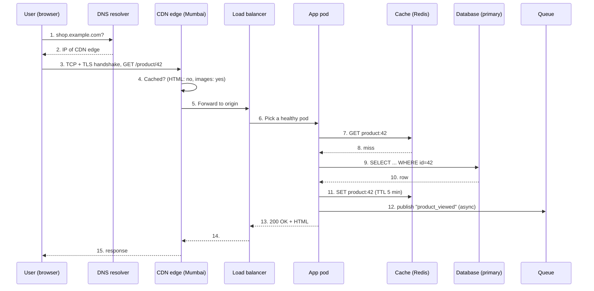

# 02 · The Map: A Request's Journey Through a Production System

> **Level:** ★ foundation
>
> **You will learn:** the **standard shape** of almost every production web system, what each box does in one sentence, the **step-by-step journey** of one request from a phone to a database and back, where **time** is spent, where things **break**, and which of your other notes (Linux, Docker, Kubernetes, CI/CD, Terraform, Ansible) builds or runs each box. Every later topic zooms into one box of this map.
>
> **You need:** topic 01.
>
> **Part 0 · How to think** · Previous: [01 · How to approach](01-how-to-approach-system-design.md) · Next: [03 · Estimation](03-back-of-the-envelope-estimation.md) · [Back to INDEX](../INDEX.md)

---

## ⚡ Core: the 10-minute version

**The idea.** Almost every system you'll design is a variation of one picture:

```
 User ─▶ DNS ─▶ CDN ─▶ Load balancer ─▶ App servers ─▶ Cache ─▶ Database
                                            │
                                            └─▶ Queue ─▶ Workers ─▶ Object storage
             (and around everything: monitoring, logging, CI/CD, IaC, security)
```

**Picture it.** A restaurant. The **sign outside** tells you the address (DNS). A **takeaway counter** near the door hands out ready-made items without bothering the kitchen (CDN). The **host** seats you at a free waiter's table (load balancer). **Waiters** take orders (app servers). The **pass** holds dishes that are already made (cache). The **pantry** is the source of truth (database). Big catering orders go on a **ticket rail** for the back kitchen to do later (queue + workers). The **manager** watches everything (monitoring).

**The one thing to know.** Each box exists to solve **one problem**: find the server, get close to the user, spread load, run logic, avoid repeated work, keep data safe, do slow work later. If you can't say which problem a box solves for *this* system, remove it.

**Try it now:**

```bash
curl -s -o /dev/null -w "dns:%{time_namelookup} connect:%{time_connect} tls:%{time_appconnect} first_byte:%{time_starttransfer} total:%{time_total}\n" https://www.wikipedia.org
```

You'll see time spent in DNS, TCP connect, TLS, and waiting for the server. That's the journey, measured.

**You've got it if you can:** draw the map from memory, say what each box does in one sentence, and walk a request through it in numbered steps.

> 📖 **That's the core.** Everything below is the **full reference**.

---

## What it is

A **reference architecture**: a standard picture that most web-facing systems resemble. Real systems add, remove or split boxes, but the shape is the same. Knowing it lets you draw a reasonable first design in two minutes and spend the rest of the interview on what's special.

| Box | One-sentence job | Topic |
|---|---|---|
| **Client** | Browser, mobile app, or another service making the request. | 06 |
| **DNS** (Domain Name System) | Turns `shop.example.com` into an IP address. | 07 |
| **CDN** (Content Delivery Network) | Servers near users that cache and serve content so requests don't cross the world. | 15 |
| **WAF** (Web Application Firewall) | Blocks malicious requests (SQL injection, bots) before they reach you. | 40 |
| **Load balancer** | Spreads requests across many servers and skips dead ones. | 09 |
| **API gateway / reverse proxy** | One front door that handles auth, rate limits, routing. | 10 |
| **App servers / services** | Run your code: stateless, many copies. | 11 |
| **Cache** | Keeps hot data in memory so we don't ask the database every time. | 14 |
| **Database** | Durable source of truth. | 16–19 |
| **Queue / stream** | Holds work to do later, smooths spikes, decouples services. | 21–22 |
| **Workers** | Process queued work (send emails, resize images, run builds). | 21 |
| **Object storage** | Cheap, near-infinite storage for files, backups, logs. | 20 |
| **Observability** | Metrics, logs, traces, alerts. | 27–29 |
| **Delivery & infra** | CI/CD builds and deploys; IaC creates infrastructure. | 32–36 |

---

## Why it exists

Start with the simplest system: **one server** running the app and the database.

```
User ─▶ [ one server: app + database ]
```

It works, until:

1. **The server dies** → whole site is down. *Fix:* more servers + a **load balancer**.
2. **More servers each need the same data** → the database moves to its own machine. *Fix:* a separate **database**.
3. **The database is slow under reads** → *Fix:* a **cache** and **read replicas**.
4. **Users far away see slow pages** → *Fix:* a **CDN**.
5. **Some work is slow (emails, video encoding) and blocks requests** → *Fix:* a **queue** and **workers**.
6. **Files and backups fill disks** → *Fix:* **object storage**.
7. **Nobody knows what's broken** → *Fix:* **observability**.
8. **Changes break production** → *Fix:* **CI/CD** and **IaC** with safe deployments.

Each box on the map is the fix for one of these pains. That's why you should **add boxes only when a requirement needs them**.

---

## Analogy

The restaurant from the Core, extended:

| Restaurant | System | When it breaks |
|---|---|---|
| Address on Google Maps | DNS | Wrong address → nobody arrives. |
| Takeaway counter by the door | CDN | Serves yesterday's menu (stale cache). |
| Host seating guests | Load balancer | Sends guests to a waiter who went home (failed health check). |
| Waiters | App servers | All busy → long waits (saturation). |
| Dishes already on the pass | Cache | Pass empties at once → kitchen swamped (cache stampede, topic 14). |
| Pantry and recipe book | Database | Pantry locked → nothing can be cooked. |
| Ticket rail for big orders | Queue | Tickets pile up faster than cooks work (consumer lag, topic 21). |
| Manager with a clipboard | Monitoring | Manager on break → problems found by angry customers. |

---

## How it works inside: one request, step by step

Scenario: a user in Mumbai opens `https://shop.example.com/product/42` on a site hosted in AWS `ap-south-1` (Mumbai region).



1. **DNS lookup.** The browser asks a **resolver** (usually the ISP's or `8.8.8.8`) for the IP. If cached, ~0 ms; if not, 20–100 ms. (Topic 07.)
2. The resolver answers with the IP of the **nearest CDN edge** (CDNs use DNS or anycast routing to pick it).
3. **Connection setup.** TCP handshake (1 round trip) + TLS handshake (1 more round trip with TLS 1.3). To a nearby edge: a few ms. To a server on another continent: 150+ ms each. This is why the CDN being close matters. (Topics 04–05.)
4. The CDN checks its cache. Images and JS are cached; this product page HTML is personalised, so it's not.
5. The edge forwards the request to the **origin** (your load balancer) over a fast, already-open connection.
6. The **load balancer** picks a healthy app instance (here a Kubernetes pod) using its algorithm and health checks. (Topic 09.)
7–8. The app asks the **cache** for product 42. **Miss** (not there).
9–10. The app queries the **database**. With an index on `id`, ~1 ms. Without, could be seconds (topic 16).
11. The app stores the result in the cache with a **TTL** (Time To Live: delete after 5 minutes) so the next 1,000 viewers skip the database.
12. The app publishes a "product viewed" event to a **queue** and does *not* wait for anyone to process it. A worker later updates recommendations. (Topic 21.)
13–15. The response travels back. Total: perhaps 60–150 ms.

### Where the time goes (illustrative)

| Step | Typical time |
|---|---|
| DNS (uncached) | 20–100 ms |
| TCP + TLS to nearby edge | 5–20 ms |
| Edge → origin (warm connection) | 2–30 ms |
| Load balancer | < 1 ms |
| App logic | 5–50 ms |
| Cache hit | ~0.5–1 ms |
| Database query (indexed) | 1–5 ms |
| Database query (no index, big table) | 100 ms – seconds |

**Lesson:** network round trips and bad database queries dominate. Code is usually not the bottleneck.

### Who builds and runs each box (your other notes)

| Box | Built/run with | Your notes |
|---|---|---|
| Servers, OS, networking | Linux (systemd, sysctl, iptables, DNS client) | [Linux 058 · How networks work](../../linux-mastery-rhel/notes/058-how-networks-work.md), [Linux 078 · nginx](../../linux-mastery-rhel/notes/078-web-servers-apache-and-nginx.md) |
| App packaging | Docker images | [Docker 14 · Dockerfile basics](../../Docker/notes/14-dockerfile-basics.md) |
| App runtime, LB inside the cluster, autoscaling | Kubernetes Deployments, Services, Ingress, HPA | [K8s 25](../../CKA-Certification-Course-2025/notes/25-deployments.md), [K8s 30](../../CKA-Certification-Course-2025/notes/30-services-clusterip.md), [K8s 69](../../CKA-Certification-Course-2025/notes/69-ingress-concepts.md) |
| VPC, LB, DB, cache, queue, DNS records | Terraform | [Terraform 32 · AWS networking](../../Terraform/notes/32-aws-networking.md) |
| VM configuration (when not containerized) | Ansible | [Ansible 57 · baseline + web stack](../../Ansible/notes/57-project-baseline-and-web-stack.md) |
| Getting code from Git to production | Jenkins / GitHub Actions | [Jenkins 63 · deploy to EKS](../../Jenkins/notes/63-project-4-part-2-deploy-to-eks.md), [GHA 53 · prod deployment](../../GitHub-Actions-Basics-To-Production/notes/53-capstone-11-prod-deployment.md) |
| Monitoring | Prometheus/Grafana, logs, traces | [K8s 80 · production observability](../../CKA-Certification-Course-2025/notes/80-production-observability.md) |

---

## Options and trade-offs: which boxes do you actually need?

| Box | Add it when… | Skip it when… | Cost of adding it |
|---|---|---|---|
| CDN | Users are spread out, or lots of static content, or DDoS risk | Internal tool, users in one office | Cache invalidation complexity, monthly fee |
| Load balancer | More than one app instance (almost always) | Truly single-instance batch jobs | Small fee; another hop |
| Cache | Same data read many times; DB under read pressure | Data always unique per request; writes dominate | Stale data, invalidation bugs, stampedes |
| Read replicas | Reads ≫ writes, DB CPU high on reads | Small load | Replication lag, more cost |
| Queue | Slow/unreliable work, spikes, many consumers of one event | Need an instant synchronous answer | Async complexity, retries, idempotency |
| Separate services | Different teams, scaling needs, release cycles | Small team, early product | Network calls, distributed failures (topic 13) |
| Multi-region | Region failure unacceptable, or global latency | Most systems | ~2× cost and hard data problems (topic 42) |

---

## Failure modes

Walk the map box by box and ask "what if it dies?". This habit alone answers half of every interview.

| Box fails | What users see | How you detect it | Fix / prevention |
|---|---|---|---|
| DNS provider down / wrong record | Site "doesn't exist" | External synthetic checks (probes from outside), DNS query monitors | Two DNS providers, sensible TTLs, change review (topic 07) |
| CDN misconfig | Stale or wrong content, or 5xx for everyone | Edge error-rate metrics, synthetic checks | Staged config rollout, quick purge, bypass to origin |
| Load balancer health check wrong | All instances marked unhealthy → 503 | LB `HealthyHostCount` = 0 alert | Health checks test the app, not dependencies (topic 09) |
| App instances crash-looping | 502/503 | Error rate, restart count | Rollback (topic 34), readiness probes |
| Cache down | Everything slower, DB overloaded | Cache hit ratio drop, DB CPU spike | Treat cache as optional; protect DB with limits (topic 14) |
| DB primary dies | Writes fail | Connection errors, replication status | Automatic failover to replica (topic 17) |
| Queue backs up | Delayed emails/jobs | Consumer lag / queue depth alert | Scale workers, DLQ for poison messages (topic 21) |
| Monitoring down | You're blind | Watchdog / "dead man's switch" alert | Monitor the monitoring from outside (topic 29) |

**3 AM:** you're paged "error rate 30%". Walk the map **from the user inward**: Is DNS resolving? Is the CDN returning errors or passing them through? Are LB targets healthy? Are pods restarting? Is the DB reachable? The first box that's unhealthy is where you start. Topic 58 turns this into a method.

---

## Where you'll use it

- **First 5 minutes of every design interview:** draw this, then adapt.
- **Debugging latency:** `curl -w` timings tell you which leg is slow.
- **Onboarding to a new company:** draw their version of this map; it reveals SPOFs (Single Points Of Failure) fast.
- **Writing runbooks:** one section per box: how it fails, how to check, how to fix.

---

## Design exercise

**Prompt:** An internal HR web app is used by 300 employees in one office. A teammate proposes: CDN + WAF + API gateway + 6 microservices + Redis + Kafka + multi-region database. Review it using the map.

<details>
<summary><b>Model answer</b></summary>

300 users in one office is tiny (well under 1 request/second on average). Most boxes solve problems this app doesn't have:

- **CDN:** users are in one place → not needed. (A corporate network may already cache.)
- **WAF:** if it's internal-only behind VPN/SSO, a WAF adds little. If internet-facing, keep a managed WAF; it's cheap insurance.
- **API gateway + 6 microservices:** a single well-structured app (a "modular monolith", topic 13) is far easier to run. One team, one deploy.
- **Redis:** the database will easily handle the load.
- **Kafka:** no event fan-out need; if there's slow work (payslip PDFs), a simple managed queue or background job is enough.
- **Multi-region DB:** HR data must be durable, but the requirement is "don't lose data", not "survive a region outage in seconds". **Multi-AZ** database + daily cross-region **backups** meets it at a fraction of the cost.

**Proposed:** DNS → load balancer → 2 app instances in 2 AZs → managed Postgres Multi-AZ with automated backups (copied to a second region) → object storage for documents. SSO in front. Monitoring with uptime check + error-rate alert. Simpler, cheaper, and actually more reliable because there are fewer moving parts.
</details>

---

## Quick recap

- Standard map: client → DNS → CDN → LB → app → cache → DB, plus queue → workers, object storage, and observability around it.
- Each box solves one problem; add it only when a requirement needs it.
- Network round trips and bad DB queries usually dominate latency.
- Debug and design by walking the map box by box: "what if this dies?"
- Your Linux, Docker, K8s, CI/CD, Terraform and Ansible notes each build or run specific boxes.

### Interview questions

1. **Q: Walk me through what happens when a user opens your site.**
   A: DNS resolves the name (possibly to a CDN edge), the client opens TCP and TLS, the CDN serves cached static content and forwards dynamic requests to the origin load balancer, which picks a healthy app instance. The app checks the cache, falls back to the database on a miss, fills the cache, pushes any slow side-effects to a queue, and returns. I'd mention where time goes (round trips, DB) and where each step can fail.

2. **Q: Why not just add every component "to be safe"?**
   A: Every component is another thing to deploy, patch, monitor, pay for and debug, and a new failure mode. A cache adds staleness and stampede risk; microservices add network failures. I add a box when a requirement or a measured bottleneck needs it, and I state what it costs.

3. **Q: Users report the site is slow but your app dashboards look fine. Where do you look?**
   A: Outside the app: DNS resolution time, CDN cache hit ratio and edge latency, TLS handshake time, load balancer latency/queueing, and client-side (large assets). `curl -w` from different locations and real-user monitoring split the time per leg. App dashboards only measure from the moment the request reaches the app.
