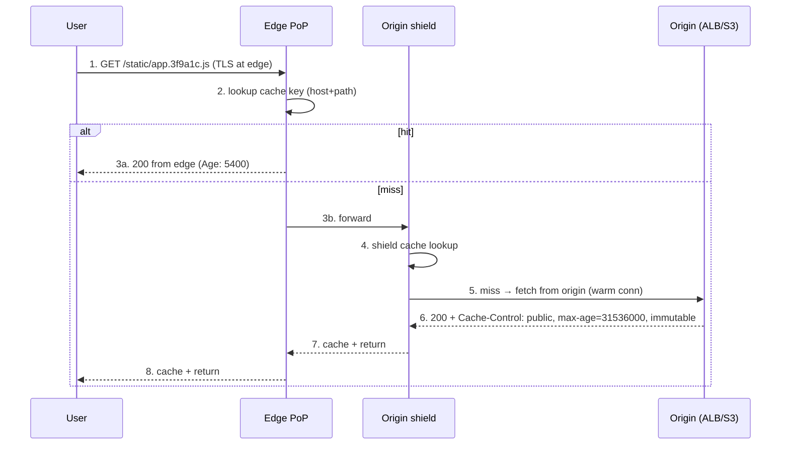

# 15 · CDN and Edge

> **Level:** ★★ intermediate
>
> **You will learn:** what a **CDN** is, how **edge locations, regional caches and origin shield** work together, the **cache key** and how it makes or breaks your hit ratio, **Cache-Control** headers in practice, **static vs dynamic** content, **purging/invalidation** and **versioned asset URLs**, **signed URLs**, **edge compute**, how a CDN absorbs **DDoS**, the AWS/GCP/Azure options, and the CDN failures that take whole sites down.
>
> **You need:** topics 05, 06, 07, 14.
>
> **Part 3 · Caching and data** · Previous: [14 · Caching](14-caching.md) · Next: [16 · Database fundamentals](16-database-fundamentals.md) · [Back to INDEX](../INDEX.md)

---

## ⚡ Core: the 10-minute version

**The idea.** A **CDN** (Content Delivery Network) is a large set of servers (**edge locations / PoPs**: Points of Presence) spread around the world that **cache your content close to users** and forward the rest to your **origin** (your load balancer or S3 bucket) over fast, warm connections.

```
User (Delhi) ──5 ms──▶ Edge (Delhi) ── hit? ──yes──▶ response
                                     └─ miss ──▶ Regional cache / Origin shield ──▶ Origin (Mumbai)
```

**Picture it.** Local convenience stores stocking popular items from the central warehouse. You get milk in 2 minutes instead of driving to the warehouse. Rare items are ordered from the warehouse on request.

**The one thing to know.** **Version your static assets** (`app.3f9a1c.js`) and cache them for a year; keep HTML short-lived. Then you almost never need to purge, and deploys are instant and safe.

**Try it now:**

```bash
curl -sI https://www.wikipedia.org | grep -iE "cache-control|age|x-cache|server"
```

`Age` = seconds the object has been in the cache; `x-cache: HIT/MISS` (header name varies by CDN).

**You've got it if you can:** design cache headers for a web app, explain the cache key, and explain origin shield.

> 📖 **That's the core.** Everything below is the **full reference**.

---

## What it is

| Term | Meaning |
|---|---|
| **Edge / PoP** | A CDN data centre near users (hundreds worldwide) |
| **Origin** | Where the real content lives: S3 bucket, ALB, API |
| **Origin shield / regional edge cache** | An extra cache layer between edges and origin so many edges share one cache fill |
| **Cache key** | What makes two requests "the same object": by default host + path (+ maybe query string, headers, cookies) |
| **TTL** | How long the edge keeps the object (from `Cache-Control` or CDN config) |
| **Purge / invalidation** | Removing objects from the edge before TTL ends |
| **Signed URL / cookie** | Time-limited permission to fetch private content from the CDN |
| **Edge compute** | Small functions running at the edge (Lambda@Edge, CloudFront Functions, Cloudflare Workers, Fastly Compute) |

Providers: **AWS CloudFront**; **GCP Cloud CDN / Media CDN**; **Azure Front Door**; independents: **Cloudflare, Akamai, Fastly**.

---

## Why it exists

1. **Latency:** physics (topic 03): a TCP+TLS handshake to a server 200 ms away costs ~400 ms. To an edge 5 ms away: ~10 ms. The edge keeps warm connections to the origin.
2. **Offload:** a 95% hit ratio means the origin sees 5% of requests and bytes.
3. **Cost:** CDN egress is usually cheaper than cloud egress from the origin, and AWS doesn't charge for origin → CloudFront transfer.
4. **DDoS absorption:** a CDN's huge, distributed capacity soaks attacks before they reach you; WAF rules run at the edge.
5. **Availability:** edges can serve stale content when the origin is down.

---

## Analogy

Convenience stores (Core). Extras:
- **Origin shield** = a regional distribution centre: 100 stores restock from it, so the central warehouse gets one order, not 100.
- **Cache key with cookies** = the store treating every customer's order as unique because they have different loyalty cards, so nothing is ever "in stock".
- **Purge** = recalling a product from every store shelf.

---

## How it works inside

### Request flow



### Cache-Control in practice

| Content | Header | Why |
|---|---|---|
| Versioned static assets (`app.3f9a1c.js`, images with hash) | `public, max-age=31536000, immutable` | Content never changes for that URL; new deploy = new URL |
| HTML pages (public) | `public, max-age=60, stale-while-revalidate=300` (or `s-maxage` for CDN only) | Short so deploys appear fast; serve stale while refreshing |
| Personalized pages / API responses with user data | `private, no-store` | Never in shared caches ⚠️ |
| Public API GETs (e.g. product list) | `public, s-maxage=30` | CDN caches briefly, browsers don't |
| Origin errors | CDN "error caching TTL" small (e.g. 10 s) | Don't cache a 500 for an hour; do cache briefly to protect origin |

`s-maxage` applies only to shared caches (CDN); `max-age` to everyone. `stale-if-error` lets the CDN serve stale content when the origin fails.

### The cache key: the hit-ratio killer

By default many CDNs key on host + path. If you **forward all query strings, headers or cookies** to the origin and include them in the key, every user's request becomes unique → hit ratio ~0%.

- Include only what changes the response (e.g. `?page=`, `Accept-Encoding`, maybe `Accept-Language`).
- Strip tracking params (`utm_*`).
- Don't key on cookies for public content.

### Static vs dynamic

- **Static:** JS, CSS, images, fonts, downloads, videos. Easy, high hit ratio.
- **Dynamic but shareable:** public pages, product lists. Cache seconds to minutes.
- **Dynamic personalized:** not cached, but still benefits from the CDN: TLS ends near the user, warm connections to origin, HTTP/3 to user, WAF and DDoS protection. This is "**dynamic site acceleration**".

### Purging vs versioning

- **Purge** (invalidation) takes seconds to minutes to reach all PoPs, can cost money per path (CloudFront: first 1,000 paths/month free, then charged), and a wildcard purge drops your whole cache → origin stampede.
- **Versioned URLs** (content hash in filename, generated by the build) make purges unnecessary for assets. The HTML references new filenames after deploy; old files can stay.

### Private content

- **Signed URLs/cookies:** the app generates a URL with an expiry and signature; the CDN verifies it. Used for paid downloads, private media, user uploads.
- **Origin access control:** S3 bucket accepts requests **only** from the CDN (CloudFront OAC), not public.

### Edge compute

Tiny functions at the edge for: redirects, header manipulation, A/B bucketing, auth token checks, geo-based routing, image resizing. Keep logic small: hard to debug, limited runtime, and a bug deploys globally in minutes.

---

## Options and trade-offs

| Choice | Pros | Cons |
|---|---|---|
| Cloud provider CDN (CloudFront, Cloud CDN, Front Door) | Integrated IAM, origin access control, single bill | Features vary; per-cloud |
| Independent CDN (Cloudflare, Akamai, Fastly) | Very large networks, strong security/edge compute, multi-cloud | Another vendor, origin must be public (or tunnels) |
| Multi-CDN | Survives one CDN's outage, price leverage | Complex: config parity, steering (DNS), cost |
| Origin shield on | Fewer origin requests, higher hit ratio | Extra cost, one more hop |
| Long TTL + versioning | Max hit ratio, cheap | Requires build tooling for hashed names |
| Short TTL + purge | Simple for HTML | More origin traffic; purge delays |

---

## Failure modes

| Failure | Symptom | Detect | Fix / prevent |
|---|---|---|---|
| **Caching personalized content** | User A sees User B's account page (privacy incident!) | Reports; headers audit | `private, no-store` on personalized responses; never cache when `Set-Cookie`/`Authorization` present; review cache behaviors |
| **Hit ratio collapse** (cache key too wide) | Origin overloaded, slow | CDN hit ratio metric ↓ | Narrow cache key, normalize query strings |
| **Full purge during peak** | Origin stampede | Origin RPS spike after purge | Versioned assets, targeted purges, origin shield |
| **Origin down** | 5xx at edge | Edge 5xx metrics, synthetic checks | `stale-if-error`, origin failover group (secondary origin) |
| **Bad CDN config push** | Global outage in minutes (it has happened to major CDNs) | Synthetic checks from many regions | Staged config rollout, config in IaC with review, multi-CDN for critical sites |
| **Cached errors** | A transient 500 served for a long time | Users get errors while origin is fine | Short error-caching TTL |
| **Mixed versions after deploy** | New HTML references assets not yet uploaded → 404 | 404s after deploy | Upload assets first, then HTML; keep old assets for a while |
| **Origin exposed directly** | Attackers bypass CDN/WAF | Origin traffic not from CDN | Allow only CDN IP ranges / secret header / OAC |
| **Cost surprise** | Huge egress bill (video, large downloads, bots) | Cost anomaly alerts | Bot management, rate limits, compression, lifecycle |

**3 AM:** "Users report seeing someone else's name on the page." Treat as a **security incident**: immediately bypass/disable caching for the affected path, purge, find which response was cached without `private`. Then postmortem: header tests in CI, CDN behavior rules that refuse to cache responses with `Set-Cookie`.

---

## Where you'll use it

- **Every public web design** (case studies 45, 46).
- **Static sites / SPA** (Single Page Apps): S3 + CloudFront, built and deployed by CI (topic 32).
- **Software distribution:** artifacts, container images, OS packages through a CDN (topic 47).
- **Terraform:** `aws_cloudfront_distribution`, cache policies, origin access control.
- **Security:** WAF and DDoS protection at the edge (topic 40).

---

## Design exercise

**Prompt:** A news site: 50 M page views/day, traffic spikes 20× on breaking news. Pages are the same for everyone except a small "Hi, Priya" header. Articles are edited occasionally after publishing. Design the CDN setup.

<details>
<summary><b>Model answer</b></summary>

- **Make pages shareable:** render the article HTML **without** personal data. The "Hi, name" header is loaded by a small client-side call to `/api/me` (`private, no-store`) or an edge function reading a cookie. Now the article HTML is cacheable for everyone.
- **Headers:** articles `public, s-maxage=60, stale-while-revalidate=600, stale-if-error=86400`; assets hashed with `max-age=31536000, immutable`.
- **Edits:** purge the specific article URL on edit (event from CMS → purge API). With a 60 s TTL, the worst case without purge is 1 minute stale.
- **Spikes:** 50 M/day ≈ 600 req/s average; 20× spike ≈ 12,000 req/s. With origin shield and request collapsing (edges combine concurrent misses for the same object into one origin fetch), a breaking story causes roughly one origin fetch per minute per object, not thousands.
- **Origin protection:** origin only accepts CDN traffic; WAF + bot rules at edge; origin autoscaling for the uncached API share.
- **Resilience:** `stale-if-error` keeps the site up if the origin fails; origin failover group to a static S3 copy of the homepage for disasters.
</details>

---

## Quick recap

- CDN = edge caches near users + warm connections to origin + DDoS/WAF at the edge.
- Hashed asset URLs with year-long TTL; short TTL + stale-while-revalidate for HTML; `private, no-store` for anything personal.
- Keep the cache key minimal; origin shield and request collapsing protect the origin.
- Prefer versioning over purging; avoid full purges at peak.
- Treat CDN config as code with staged rollouts; lock the origin to CDN-only traffic.

### Interview questions

1. **Q: How do you deploy a new frontend version through a CDN without stale or broken pages?**
   A: The build produces content-hashed asset filenames cached immutably for a year. Deploy uploads new assets first, then the HTML (short TTL) that references them. Old assets stay available for users still on old HTML. Usually no purge is needed; at most purge the HTML paths.

2. **Q: The CDN hit ratio dropped from 95% to 40% after a change. What happened?**
   A: Most likely the cache key widened: forwarding all query strings, cookies or a header like `User-Agent` into the key, or the origin started sending `no-cache`/`Set-Cookie`. I'd diff the cache policy and response headers, then narrow the key and fix headers.

3. **Q: How does a CDN help availability, not just latency?**
   A: It absorbs DDoS traffic across many PoPs, filters with WAF at the edge, serves stale content when the origin is failing (`stale-if-error`), supports origin failover to a secondary origin, and reduces origin load so the origin is less likely to be overloaded in the first place.
